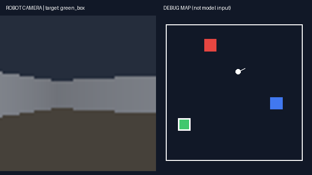

# Perception World

A small, camera-first environment for testing fast visual robot policies and learning world models. Start with a robot navigating to a named box; add richer physics and household tasks after the observation/action loop works.

**Current scope:** a deterministic, planar navigation simulator with a perspective ray-cast RGB camera. This is an environment scaffold, not a trained model, full 3D renderer, or validated real-robot simulator.



## Run

Python 3.10 or newer:

```sh
python3 -m venv .venv
source .venv/bin/activate
pip install -e '.[dev]'
pytest -q
perception-demo --episodes 3 --split test
```

Open `runs/demo/room-0.gif` to see a camera view beside a privileged overhead map. `metrics.json` records results and environment-step timing. The demo uses scripted exploration, not a trained or goal-seeking policy. Its timing includes simulation and rendering, not neural-network inference or real camera latency.

## Use your own model

```python
from perception import RoomEnv

env = RoomEnv(image_size=64, max_steps=300)
observation, info = env.reset(seed=42)
while True:
    # Replace with policy(observation, recurrent_memory).
    action = env.action_space.sample()
    observation, reward, terminated, truncated, info = env.step(action)
    if terminated or truncated:
        break
env.close()
```

- `observation['image']`: uint8 RGB, shape `(64, 64, 3)`; limited field of view and occlusion.
- `observation['target']`: integer identity: 0 red, 1 green, 2 blue. Names identify colors; the camera does not read text labels.
- `action`: float32 `[forward, turn]`, each normalized to `[-1, 1]`. Negative forward reverses. Each environment step moves at most 0.1 world units and turns at most 0.16 radians; these are abstract simulation ticks, not calibrated robot velocities.
- Reward: +1 for reaching the target, -0.01 per tick, -0.05 for a blocked move. Success is within 0.38 units of the target's surface.
- Success terminates; time limit truncates. Reset before stepping again.
- `info`: task outcomes for evaluation. Do not feed evaluation fields into a policy as observations.
- `debug_state()`: exact positions for debugging only. Keep this out of model input and training features.

Rooms vary in size, box locations, robot position, heading, and target identity. Objects are static axis-aligned boxes. Placement keeps objects separated from each other and walls, with clearance for the robot; there are no interior walls or moving obstacles. Floor, ceiling, and walls are stylized; the renderer is a 2.5D ray caster, with no calibrated depth, lighting, contact dynamics, or manipulation.

## Reproducible evaluation

`perception.env.seeds_for(split, count)` supplies disjoint lists: seed modulo 10 assigns 0 to test, 1 to validation, and 2–9 to training. This gives 80/10/10 seed partitions. Freeze evaluation lists and generator versions when comparing models. These splits hold out layouts within the same generator distribution; they do not establish generalization to new scene families or the real world.

To record action-conditioned trajectories:

```sh
python -m perception.collect --episodes 10 --split train --output runs/data
```

Each `.npz` contains T+1 images, T actions/rewards/termination flags, and a target ID. JSON metadata records seed, split, and generator version. The included collector uses random actions; learning navigation will need better exploration and/or online interaction.

## System breakdown

1. **Environment (implemented):** seeded rooms, camera observations, robot actions, collision/success signals, replay export, trajectory collection, tests.
2. **Fast local model (next):** small image encoder, recurrent memory, and actor. Measure camera-to-action p50/p95 latency on deployment hardware.
3. **World-model training (next):** connect DreamerV3 through an adapter, or train an action-conditioned predictor on recorded sequences. Evaluate multi-step predictions separately from policy success.
4. **Escalation protocol (later):** let a supervisor request help on explicit signals such as repeated collisions, lack of progress, or calibrated uncertainty. A frontier model returns bounded guidance or a subgoal; the fast controller continues local operation. Design timeouts, stale-response rejection, and a stop behavior before physical deployment. These heuristics are not safety guarantees.
5. **MCP (later):** expose world generation, training jobs, evaluation, and replay inspection. Keep network calls outside the real-time control loop.
6. **Physical simulation (later):** preserve the Gymnasium interface while adding a MuJoCo implementation for realistic bodies and contacts.

No LLM service is called and no credentials are required by this version. No critical-situation detector, trained policy, world model, or MCP server is implemented yet.

## Useful foundations

- [Gymnasium](https://github.com/Farama-Foundation/Gymnasium): environment API used here.
- [DreamerV3](https://github.com/danijar/dreamerv3): proposed first learning baseline; not yet integrated.
- [MuJoCo](https://github.com/google-deepmind/mujoco): future physics backend; not a current dependency.

MIT licensed. See LICENSE.
